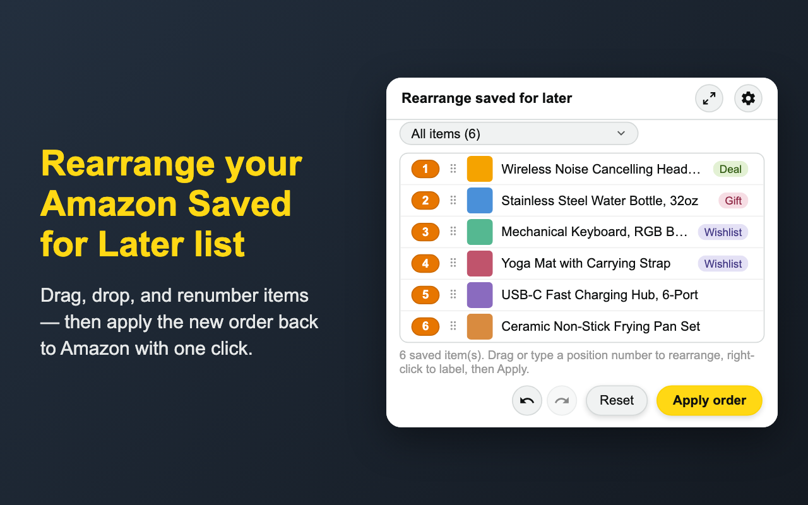
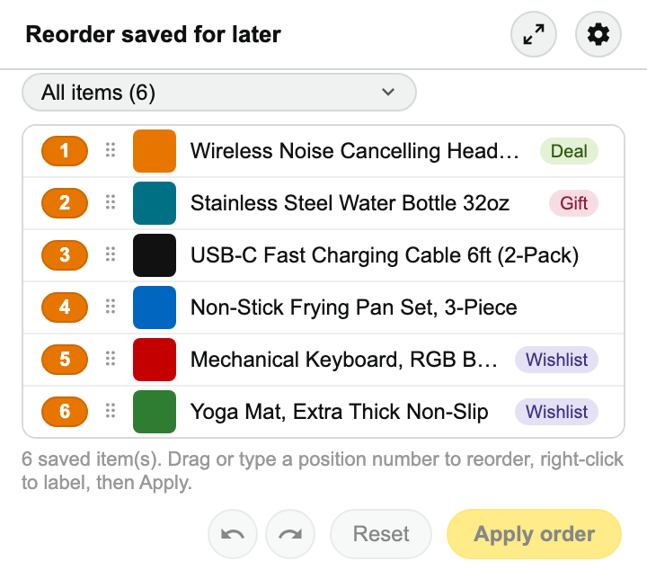
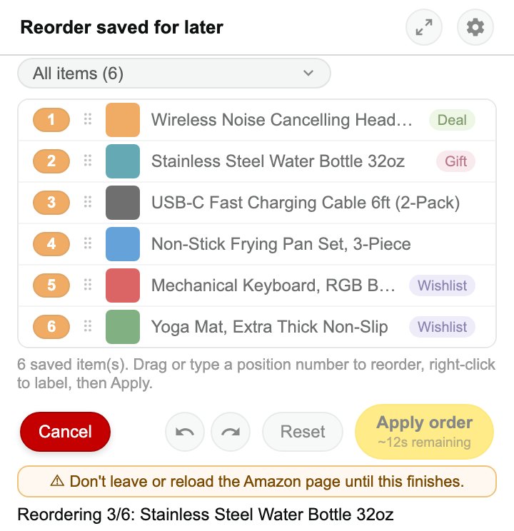

# Reorder Saved for Later - Amazon

A Chrome extension that lets you drag-and-drop (or type a position number)
to reorder the items in your Amazon "Saved for later" list, then applies
that order for real on amazon.com.

**[Get it on the Chrome Web Store](https://chromewebstore.google.com/detail/reorder-saved-for-later-a/adddgnonjdifiaepengnjopamlomjmnh)**

No data is ever collected, shared, or sent to the developer or anyone
else. Everything happens and is stored locally in your browser — unless
you turn on the optional sync, which stores your settings, labels and
price targets in your own Chrome account (see [Settings](#settings)).

| Idle | Reordering in progress |
| --- | --- |
|  |  |

## Why

Amazon has no way to reorder saved-for-later items — new saves always land
at one end of the list, and there's no drag handle or API for rearranging
them. This extension works around that by driving Amazon's own "Move to
cart" / "Save for later" controls to bump items into the position you want.

## Install

Install it from the [Chrome Web Store](https://chromewebstore.google.com/detail/reorder-saved-for-later-a/adddgnonjdifiaepengnjopamlomjmnh).

To run it from source instead:

1. Clone or download this repository.
2. Open `chrome://extensions` in Chrome.
3. Enable "Developer mode" (top right).
4. Click "Load unpacked" and select this project's folder.
5. Pin the extension for easy access.

## Usage

1. Go to your Amazon cart page and scroll down to "Saved for later".
2. Click the extension icon.
3. Drag items to reorder them, or type a number into an item's position
   badge to jump it to that spot — everything below it shifts down
   automatically.
4. Click **Load all items** if you have more saved items than Amazon has
   currently loaded on the page (shown by the "may be incomplete" banner).
5. Click **Apply order** to have the extension actually rearrange the items
   on Amazon by bumping them through Move to cart / Save for later.
6. If you close the popup before applying, your in-progress arrangement is
   preserved as long as you don't reload or navigate away from the page —
   reopening the popup restores it. Reloading/navigating/closing the tab
   resets it back to the page's real order, and the **Reset** button lets
   you do that manually too.
7. Use the undo/redo buttons (or ⌘Z / Ctrl+Z and ⇧⌘Z / Ctrl+Y) to step
   back and forth through your changes before applying.
8. Select several items — ⌘+click (Ctrl+click on Windows/Linux) to pick
   them one at a time, Shift+click to select a range — then drag any one
   of them to move the whole group together.

The toolbar icon is greyed out except on Amazon cart pages, where the
extension can actually do something.

## Labels

Right-click an item to tag it with labels like "Grocery" or "Electronics".
An item can have several labels. Use the filter dropdown to show only items
with a given label — reordering while filtered still moves items within
your full list, and **Apply order** always applies the whole list. Turn on
"Show interposing items" to also see, dimmed, the unlabeled items sitting
between your filtered ones (the button only appears when there are some).

The filter dropdown also has **＋ New label…** and **✎ Edit labels…**. The
editor renames, recolors, reorders, and deletes labels — click **Done** to
save your edits, or close it (✕, click outside, or Escape) to discard them.
Labels are saved locally in your browser and stick to items across
sessions.

The right-click menu also has **Add to cart (keep in Saved for later)**,
which puts a copy of the item in your cart while it stays where it is in
your list — unlike Amazon's "Move to cart". It submits the product page's
"Add to Cart" in the background, so refresh the cart page to see it there;
items that need an option picked (size, color…) or have no Add to Cart
button on their product page can't be added this way. It also has
**Open product page** and **Price history on
camelcamelcamel** (both open in a background tab; nothing is sent to
camelcamelcamel unless you click it), and **Delete from Saved for later…**,
which removes the item from your list on Amazon (after a confirmation) by
clicking Amazon's own "Delete" link. Deleting is permanent and can't be
undone from the popup.

## Price targets

Right-click an item and pick **Label at a target price…** to have a label
added automatically while the item's price is in a range you choose — a
lowest price, a highest price, or both. An item can have several targets,
e.g. "Good price" at $40 and "Buy now" at $20: the right-click menu lists
each one to edit, plus **Add another price target…**. If the price later
leaves the range, the label comes off again (unless the item already had
it). Remove the label by hand while the price is in range and it stays off
until the price leaves the range and comes back.

Labels used for price targets are kept apart from your other labels: they
have their own **Price target labels** group in the dropdowns and the label
editor, and aren't in the item right-click menu. In the Saved for later
list, each target shows as a pill with its target price (e.g. `$40.00`
`$20.00`) next to the item's other labels, green while the current price is
in range — hover it to see which label it applies and the current price.

When a target is hit, a **Price target hit** notification shows at the top
of the popup: **Edit** the target, **Dismiss** it until the price changes,
or **Don't show again** (turn it back on by editing the target and ticking
"Notify me").

### Price targets tab

Once you have a price target, a **Price targets** tab appears next to Saved
for later, with one row per target — including items no longer in your
list (dimmed, with the last price seen). Each row shows the target's label,
the item's other labels, the target, the current price, and how far off it
is ("$4.50 above target" in red, "$1.01 under target" in green). Drag rows
(⠿) to arrange them; click a row to edit its target, or right-click it to edit or delete the target, add
another, or open the product page or its camelcamelcamel history. Its
filter dropdown shows targets by status (in range, not in range, not on the
page, notifications off) or by label, and its **＋ New label…** creates a
price-target label. In the grid view the targets show as cards (or table
rows) like your saved items, and hovering a thumbnail enlarges it on both
tabs. If Amazon may not have loaded your whole list yet, the tab's footer
offers **Load all**, since items that simply haven't loaded also show as
"Not on this page". The popup reopens on whichever tab you were last on,
until the cart page is refreshed.

Prices are read from the cart page, so targets are only checked while the
popup is open on your cart — there's no price tracking in the background.
A target only works while its item is in your Saved for later list: once
the item leaves the list (bought, moved to the cart, or deleted), its price
isn't checked and it won't notify you, though the target stays on the Price
targets tab until you delete it. Prices are in whatever currency your
Amazon storefront shows.

## Settings

Click the ⚙ button to adjust:
- **Theme** — Auto (follows your system's light/dark setting), Light or
  Dark.
- **Delay between actions** — how long to wait between each bump step
  (default 500 ms; going lower isn't recommended).
  Increase this if Amazon's page feels slow to respond and items get
  missed or duplicated.
- **Refresh the page after applying the order** — reloads the page once
  reordering finishes, so you see the final result immediately.
- **Sync across computers → Sync automatically** — off by default. When on, your settings, labels and price
  targets are kept in sync through your own
  Chrome account, on every computer where you're signed into Chrome with
  extension sync enabled and have this turned on. Nothing goes to the
  developer or anyone else. If both this computer and your Chrome account
  already have different labels or price targets the first time you sync
  (turning this on, or Sync now), you'll be asked which to keep; after that,
  the most recent change wins.
  Chrome limits synced data to 100 KB — room for a few thousand labeled
  items, or a few hundred price targets (each remembers its item's title
  and link; thumbnails aren't synced and reappear once the item is seen
  on the cart page). Past that, everything keeps working on each computer
  but stops syncing. Your in-progress
  arrangement is never synced. While automatic sync is on, the popup's
  header shows when it last synced (or that it failed); click it to open
  these settings. Settings always shows the last sync.
  - **Sync now** syncs right away. It works with automatic sync off too, if
    you'd rather sync only when you choose.
  - **Delete synced data…** removes your settings, labels and price targets from your
    Chrome account and turns sync off on all your computers. Each computer
    keeps its own copy, and you can turn sync back on later.

## Limitations

- **Unavailable items are skipped.** Items marked "Currently unavailable"
  or "This item is no longer available from the seller you selected"
  don't have a working "Move to cart" control, which is what the
  extension relies on to detect and move saved items. These items won't
  show up in the extension's list at all, can't be reordered, and will
  stay wherever they currently sit in your real saved-for-later list.
- Reordering works by actually moving items to your cart and back, so it
  takes a few seconds per item — the more items you reorder, the longer
  Apply takes.
- Amazon's page markup isn't versioned or guaranteed stable; if Amazon
  changes their cart page layout, item detection may need updating.

## Support

If this saved you some tedious clicking, you can
[buy me a coffee](https://www.buymeacoffee.com/maxwellluong).

## Project

[github.com/maxandcheeses/chrome-reorder-saved-for-later-amazon](https://github.com/maxandcheeses/chrome-reorder-saved-for-later-amazon)
